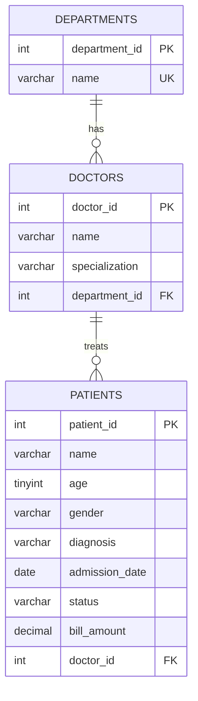

# Hospital Management System: DBMS Lab Report

## 1. Title
Hospital Management System

## 2. Objective
Build a small single-page application that stores, retrieves, updates, and deletes hospital patient records using SQL, and shows summary statistics computed with aggregate functions.

## 3. Tools used
- MySQL 8 (database and SQL)
- Node.js with Express and `mysql2` (API layer, parameterised queries)
- HTML, CSS, and JavaScript (single-page interface)
- Git and GitHub (version control)

## 4. Database design (ER diagram)



Foreign keys: `doctors.department_id -> departments.department_id` and `patients.doctor_id -> doctors.doctor_id`. CHECK constraints restrict `gender`, `status`, and `bill_amount`.

## 5. Key SQL queries

**CREATE** (see `database/schema.sql` for all tables)
```sql
CREATE TABLE patients (
  patient_id INT UNSIGNED NOT NULL AUTO_INCREMENT PRIMARY KEY,
  name VARCHAR(80) NOT NULL, age TINYINT UNSIGNED NOT NULL, ...
  doctor_id INT UNSIGNED NOT NULL,
  CONSTRAINT fk_patient_doctor FOREIGN KEY (doctor_id) REFERENCES doctors (doctor_id)
);
```

**INSERT**
```sql
INSERT INTO patients (name, age, gender, diagnosis, admission_date, status, bill_amount, doctor_id)
VALUES ('Rahim Uddin', 58, 'Male', 'Hypertension', '2026-10-02', 'Admitted', 1250.00, 1);
```

**SELECT with WHERE (search/filter)**
```sql
SELECT p.*, d.name AS doctor_name
FROM patients p JOIN doctors d ON d.doctor_id = p.doctor_id
WHERE p.name LIKE '%rah%' AND p.status = 'Admitted';
```

**UPDATE**
```sql
UPDATE patients SET status = 'Discharged', bill_amount = 1300.00 WHERE patient_id = 1;
```

**DELETE**
```sql
DELETE FROM patients WHERE patient_id = 12;
```

**Aggregates (summary section)**
```sql
SELECT COUNT(*), AVG(bill_amount), MAX(bill_amount), MIN(bill_amount), SUM(bill_amount) FROM patients;

SELECT d.name, COUNT(p.patient_id) AS patients
FROM doctors d LEFT JOIN patients p ON p.doctor_id = d.doctor_id
GROUP BY d.doctor_id, d.name;
```

## 6. Screenshots
Add before submitting (run the app, then capture):
1. Full page with summary cards and the records table
2. Add-patient form filled in
3. Search result (for example, search "heart")
4. Edit mode with a row loaded into the form
5. Delete confirmation dialog

## 7. Conclusion
The application meets the lab requirements: normalised tables with primary and foreign keys, full CRUD through SQL, search and filtering with `WHERE`, and aggregate summaries on a single page.
